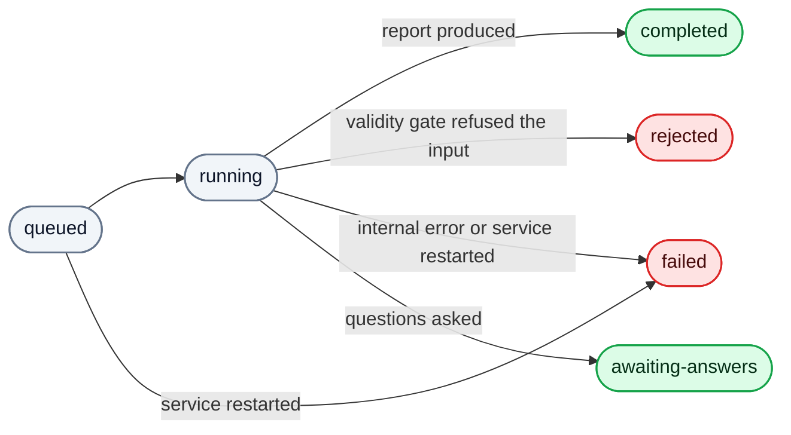

# HTTP API

The `/v1` job API is the decoupled surface for a front end. It is async:
submit text, get a job handle, poll or stream until the report is ready. For an
in-process integration prefer [`Engine`](Integration-Guide.md) — it drives
the same pipeline without the job/auth/polling machinery.

Build the app with `create_app()`; every seam is injectable, defaulting to
production wiring.

```python
from analysis_service import create_app

app = create_app()  # configured store, real pipeline, configured JWT verifier
```

See [Configuration](Configuration.md) for the required
[`ANALYSIS_AUTH_PROVIDER` / `ANALYSIS_OIDC_*`](#bearer-auth),
the [`ANALYSIS_JOB_STORE`](#job-storage) backend
selection, and the
[credentials](Configuration.md#provider-environment) for whichever model vendor
each tier uses.

## Auth

Every `/v1` route requires a bearer JWT (RS256, verified against the configured
issuer, audience, and JWKS) from the selected auth provider — see
[Bearer auth](#bearer-auth) below for supported identity providers and setup.
Job reads are **owner-only**: a request from
anyone but the job's owner gets `404`, not `403`, so job IDs cannot be probed
for existence. Rejection detail is generic on purpose — the real reason is
logged, never returned.

The token's issuer and `sub` claim name a **Principal**. The service gives each
principal a random owner ID, and that owner ID owns each job of the principal
(ADR 0064). Two identity providers that issue the same `sub` give two
principals. The service creates a principal only when it admits the first job
of the token, so a read creates none, and a refused submission leaves none. A
token whose principal does not exist yet gets the same `404` as a missing job.

## Routes

| Method | Path | Purpose |
| --- | --- | --- |
| `POST` | `/v1/jobs` | Submit an ordered list of sources; returns a job handle. `429` when this token is already at its [concurrency ceiling](#how-many-jobs-you-may-run-at-once). |
| `GET` | `/v1/jobs/{id}` | Poll: status, per-node progress, timestamps. Never the report. |
| `DELETE` | `/v1/jobs/{id}` | Delete a job that has ended; `204`. `409` where the job is queued or running. See [Deleting a job](#deleting-a-job). |
| `GET` | `/v1/jobs/{id}/events` | The same progression as Server-Sent Events; resumable via `Last-Event-ID`. |
| `GET` | `/v1/jobs/{id}/report` | The full [report](Report-Schema.md) once completed; `409` before, and `409` if the report is withheld (below). |
| `GET` | `/v1/jobs/{id}/changes` | For a follow-up, how each finding moved since the report its answers came from: `new`, `unchanged`, `changed` (with the verdict before and after) or `gone`. Matched by claim identity, never by prose. `409` where the job is not a follow-up, where the earlier report is no longer held, or where either report is withheld or [from an older schema version](#a-job-from-an-older-schema-version). |
| `POST` | `/v1/jobs/{id}/corrections` | Correct a final report's answers, as `{"facts": [...], "revision"}`: a changed value, or `unknown`. `200` with `{"job_id", "revision", "corrections", "corrected_findings"}`. No job starts, and the report is not rewritten. `400` where the report is not final, a correction names no answer the report read, or changes none. `409` where another correction moved the revision. `422` where `revision` is missing. |
| `POST` | `/v1/jobs/{id}/answers` | Answer the questions of a completed job or a job in `awaiting-answers`. Starts a **new** job that resumes from this one's model and catalog; `201` with its `job_id`. With `"save": true`, a waiting job keeps the answers, and a completed job keeps a draft of its follow-up; either answers `200` with its own `job_id`, and a save never starts a job. `409` where a save moved the answers after this request read them. |
| `POST` | `/v1/jobs/{id}/amendments` | Amend a job in `awaiting-answers`, as `{"text", "revision"}`: what is true that its model misses or reads wrongly. Starts a **new** job that extracts the job's sources again with the amendment added, and pauses again; `201` with its `job_id`. `409` where the revision has moved, before or while the request reads it, or a job already locks this one. `422` where `revision` is missing. |
| `GET` | `/v1/jobs/{id}/questions` | What the job asks you, as `{"job_id", "link_questions", "fact_questions", "early_questions", "early_blocked", "early_unnecessary", "policy_version", "fallback", "final", "early_stop", "early_held_back", "early_below_floor", "early_summary", "framework_gates", "skipped_early", "skipped_links", "answered_early", "answered_links", "revision", "resumed_by", "draft_links", "draft_facts", "answer_limits", "carried_dropped", "carried_dropped_links"}`: a finished report's questions, or a waiting job's link and early questions. `resumed_by` names the job this job's answers started while that job is in flight or has its report; the job then asks nothing until that job fails. Derived from the report when you ask, under the report's own rules: `409` before completion and `409` when the report is withheld. |
| `GET` | `/healthz` | Unauthenticated liveness probe. |

Errors are RFC 9457 `application/problem+json`.

### When the report is withheld

A completed job's report can still be refused, and so can a waiting job's
questions and answers. Before serving it, the service
checks the run's **fingerprints** — a per-node hash of the model build that
answered plus that tier's decoding parameters — against the list this deployment
has **blessed** (approved by a measured run, in
`config/blessed-fingerprints.toml`). Two cases refuse with `409`:

- the run is **uncertified** (a fingerprint isn't blessed) *and*
  `ANALYSIS_REQUIRE_CERTIFIED` is set — off by default;
- the run is **unexercised** (a tier the graph declares produced no fingerprint
  at all) — always refused, and not reachable on a run that produced a report.

A job that waits on answers is checked over the nodes it ran before it paused,
and the questions route and the answers route refuse under the same two rules.
The job that your answers start carries the result of the job you answered,
waiting or finished, and its report is served only where both runs pass.

The problem body names the unblessed nodes and their hashes, and the tiers that
went unexercised. It never includes the analysis. The job itself stays
`completed` — withholding refuses the delivery, not the work, because the
fingerprints that show what drifted live inside the report. Nothing about this
appears in `GET /v1/jobs/{id}`; it is operator-facing only. See
[Architecture](Architecture.md#provenance-and-certification).

### A job from an older schema version

Each job stores the [`schema_version`](Report-Schema.md) of the service that
created it. A new version can change a shape that the service cannot parse in
an older record, and no migration rewrites a stored job. The questions,
answers, corrections and amendments routes, `/changes`, and a submission with
`answers_from` return `409` for a job whose version is not the current one. The
`detail` names the stored version and the current version, and tells you to
submit the job again.

`GET /v1/jobs/{id}`, its events, `DELETE /v1/jobs/{id}` and
`GET /v1/jobs/{id}/report` serve a job of any version. These routes parse no
part of the job that the version covers: the sources, the checkpoint, the
resumption and the report. The report route returns the report as the service
stored it, so read its own `schema_version`. A job that is not yours reads as `404`, never as `409`.

A job can also hold a stored value that the service no longer lists, such as
a removed issue code, status or event kind. Such a job is unreadable, as a
job of another version is ([ADR 0095](adr/0095-a-stored-part-that-does-not-parse-makes-a-job-unreadable.md)).
`GET /v1/jobs/{id}` returns it with the status `unreadable`, the times, and
no progress. Its events, its report and each route above return `409`, so a
report whose certification does not parse is never served.
An unreadable job has ended, whatever its stored status. It takes none of
your in-flight slots, `DELETE /v1/jobs/{id}` deletes it, and the
[retention sweep](#retention) deletes it. An unreadable resumed job locks the
job it resumes only where its stored status is `completed` or
`awaiting-answers`.

### Deleting a job

`DELETE /v1/jobs/{id}` deletes a job and returns `204` with no body. Only the
**Owner** can delete a job, and only a job that has ended: a job in a terminal
status (`completed`, `failed`, `rejected` or `awaiting-answers`), or an
[unreadable job](#a-job-from-an-older-schema-version). A `queued` or `running`
job returns `409`, and the job stays as it is. A job that is not yours, a job that does not
exist and an ID that is not `job-` with 32 lowercase hex digits all return the
same `404`. The service checks the ID before it looks for the job.

The delete removes the content of the job: its sources, its report, its
checkpoint, its answers, its corrections and its events. Each route then
returns `404` for the job. The service keeps a usage row for the job, which no
route reads (ADR 0066). The row holds the owner ID, the creation time, the
tokens, the status and the parent job ID. So a deleted job still counts toward
the rate and the token [budgets](#how-much-you-may-consume-over-time). A
deleted follow-up still uses the one follow-up of its report. No new job can
take the ID of a deleted job.

On the `sql` store, the delete changes the job row into the usage row in one
transaction, and then deletes the objects. When the object store does not
delete an object, the route still returns `204`. The service log gets a
warning with the key of the object, and the
[orphan sweep](#orphan-objects) removes the object later.

Each delete writes one line to the service log. The line names the job ID, the
owner ID, the cause and the number of stored objects that the delete removed.
The cause is `owner` for a delete through this route and `retention` for a
delete by the [retention sweep](#retention). The cause is `workspace` for a
delete by the bound of the [web app](Web-App.md#where-the-runs-are-kept). The
line holds no content of the job.

## Lifecycle



- `completed` — the report is available at `/v1/jobs/{id}/report`.
- `rejected` — the input failed the validity gate; the poll response carries the
  `validation_issues` (see [Report-Schema](Report-Schema.md)).
- `failed` — an internal error; only a generic message is exposed. A job that
  is `queued` or `running` when the service stops also fails, at the next
  startup, with the message "the service restarted during the analysis; submit
  the job again". The service never runs it again on its own, because that is
  a second paid run that nobody submitted. The job keeps its full token
  charge.
- `awaiting-answers` — only for a job submitted with `"questions": true`. The
  run stopped after its assertion pass and waits for you, for as long as it
  takes. `GET /v1/jobs/{id}/questions` lists what it asks, and
  `POST /v1/jobs/{id}/answers` continues it as a new job (see below). A waiting
  job takes none of your in-flight slots.
- `unreadable` — only in the poll response, never a stored status. The job
  holds a stored value that this service no longer lists. See
  [A job from an older schema version](#a-job-from-an-older-schema-version).

This mirrors the engine's three outcomes; the HTTP layer adds the queue,
ownership, and delivery around them.

## Submit and poll

```http
POST /v1/jobs
Authorization: Bearer <jwt>
Content-Type: application/json

{
  "sources": [
    {"kind": "description", "label": "Architecture note",
     "text": "Customers sign in and place orders..."},
    {"kind": "transcript", "label": "Kickoff call, 14 May",
     "text": "Ana: the orders DB is Postgres. Bob: I think it's 13."}
  ],
  "frameworks": [{"name": "stride"}],
  "system_name": "Orders"
}
```

`frameworks` is **required and non-empty**, and names which security frameworks
this job is analysed under. There is no default: a contract that picked one for
you would mean two different things on two deployments, and a job that silently
analysed fewer frameworks than it asked for is worse than one that refused. Each
entry is `{name, options}`, where `options` defaults to `{}` on the envelope and
the named package's own model decides what it needs — so a framework requiring a
job-level value rejects a submission that omits it, naming the field. Which
names a deployment carries is its `config/frameworks.toml`; an unknown one is
refused on the input ladder, before a job record exists and before anything is
billed.

The report answers exactly this set, one block per framework, in this order.

Each source is `{kind, label, text}`. `kind` is `description` or `transcript`
and selects the guidance extraction reads the text under. A third kind,
`answers`, is composed by the service from `links` (below); a submission that
sends one itself is refused. `label` is yours: it
must be unique within the job, at most 200 characters and single-line, and it
is the key every `source_excerpt` in the report cites, so pick something you
will recognise. Order is presentation only — **sources carry equal weight**, and
an earlier one does not override a later one. A single-source job is a
one-element list.

### Answering link questions

A report can ask which element of the model a **principal** is: "shopper
accounts", "the calling teams", "ML engineers". The sources state facts about
these principals, such as "no MFA for shopper accounts", but never say which
element each one is, so no rule can place those facts.
`GET /v1/jobs/{id}/questions` lists the questions, and the report page shows
the same list. Each entry is `{key, principal, rows, options, suggested}`:
`rows` is how many stated facts an answer would place, and `options` lists the
elements an answer may name, each as `{id, name}`. `suggested` is the one
option whose name matches the principal, ignoring case, punctuation and a
plural, or `null`. It is a suggestion only: nothing is placed until you answer.
The most rows come first.

**Ask before the analysis runs.** Submit with `"questions": true` beside the
sources. The job stops after extraction, and after the assertion pass where
the deployment runs one. It ends in `awaiting-answers` and waits. Its
questions come from what it has read so far. Answer them with the route below,
or send `{"links": []}` to continue without answers; either starts the
analysis as a new job. A job submitted without `questions`, such as an
autonomous run, never stops. A deployment that builds no assertion catalog
asks no link question, and asks its early questions.

A waiting job also lists `early_questions`: the open facts of its model, most
likely needed first, before any finding exists. Each entry is
`{key, kind, label, reasons, choices, form, suggestions, facets, max_length,
group, group_heading, element, excerpt}`. `kind`, `form`, `suggestions`,
`facets` and `max_length` are as they are for a report's open facts below.
`choices` lists each choice as `{id, name}`: `name` is the element's name
where the choice is an element, and empty otherwise. `excerpt` is the words
of the source the question's element was read from, and empty where the
question names no element. `group` is the question kind or the attribute, and
`group_heading` is its question with no element named, so a page can ask each
once and list the elements under it by their `element` name. The list keeps
its order within and across groups.
`reasons` gives the questions of the rules that fire on the element, which say
why the fact matters. `score` is the value the list is ranked by. An attribute is asked only where the model, with the
assertion catalog applied, leaves it open: `unknown`, possibly with a
qualification after it, or a zone the service inferred. Answer them as `facts` on the route below. The analysis then
reads your answers, so the findings rest on them.

**A waiting job asks one adaptive list**
([ADR 0078](adr/0078-a-paused-job-asks-one-adaptive-list.md)).
`early_questions` holds every recommended question of the pause at once, the
most useful first, and `policy_version` names the policy that built it
(`adaptive-1`). Each question's `decisions` counts its choices: one a facet,
else one. A field question needs a `score` of at least 1, and a capability
question at least 2. One pause asks at most 30 capability questions for each
selected framework, and a question two frameworks share counts for each of
them ([ADR 0074](adr/0074-each-framework-has-its-own-question-limit.md)).
Field questions have no limit: the floor decides which of them the list asks
([ADR 0088](adr/0088-field-questions-have-no-limit.md)). A
capability question whose `parent` is still open is not in the list: it is in
`early_blocked`, with the `reason` `parent-undecided`, takes no place, and
joins the list once the parent is answered "yes". Within a framework's turn,
the list ranks a capability by its band and the units it could settle, and a
field question by the prior per choice; what an answer would settle breaks a
tie. Each capability row carries `rank`: `settles_at_most` and `settles_at_least` over
its answers, and for each answer what it `settles`, which is the other
questions it proves settled or unnecessary, and what it `unlocks`, which is
the questions it adds to the list. A field row's `rank` is `null`: no rule
proves that a field answer removes another question. Answers can add
questions as well as take them away. `early_unnecessary` lists each question
of the first list that a saved answer proved unnecessary, with its
`reason`: `parent-absent`, `gate-satisfied`, `gate-refuted`, `fact-settled`
or `no-longer-needed-by-selected-units`.

Send answers with `"save": true` to keep them: they are written onto the job,
no model runs, and the response is `200` with `{"job_id", "saved": true}`.
Ask for the questions again for the list with them in. A save may also send
`"skip"`, a list of keys of listed questions that you set aside for now. A
skip is not an answer: the fact stays open, the list leaves it out, and it
takes no place under the limit. A link question is skipped by its `key`, a
string; the skip places the principal nowhere and is not `"none"`.
`skipped_early` lists every skipped early question and `skipped_links` every
skipped link question, and an answer to one is still taken. A question with
facets may be skipped beside a part answer to it: the facets sent are kept,
and the rest are set aside. A skip beside a complete answer is refused. A
save must answer or skip at least one question.

**Say what you presented.** A save or a start to a waiting job sends
`presented`, the keys of the early questions your page showed. The job records them as shown, and the
report reads that record to tell a skipped question from one left blank or
never shown ([ADR 0069](adr/0069-a-skip-is-of-a-question-the-page-presented.md)).
A skip is taken only of a presented question. A key the list does not hold is
refused with `400`. A question
the service returned and your page did not show is not recorded as shown, so
send only what you rendered.

**Send the revision you read.** `revision` counts a job's saves: a waiting
job's saves, a finished report's saved drafts, or a final report's
corrections. Every answer to a waiting job, every save and every correction
carries the `revision` its questions were read with: `400` where it is missing, and `409` where another save landed first. Of
two saves that read one revision, only the first lands, so a page left open on
an earlier revision cannot write over a later one. Read the questions again after
a `409`. A finished report's run may send its `revision`, and is checked
against it where it does. A save never starts
the analysis: when the saved answers leave nothing to ask, the questions say
so in `early_stop`, and a send without `"save"` starts it. `answered_early` and `answered_links` list each saved answer
with its question, and you can send a new answer to any of them. A question
with facets stays listed while a facet has no answer.

**A stop does not say every fact is settled**
([ADR 0068](adr/0068-a-pause-says-what-it-leaves-open.md)). `early_stop` is
`null` while the job asks something. It is `budget-exhausted` when the limits
hold questions back, `below-floor` when only questions under a floor are left,
`skipped` when every question left was skipped, and `nothing-left` when no open
question is left. `early_held_back` lists the
questions the limits hold back (`reason` `answer-limit`), and
`early_below_floor` the open questions under a floor (`below-floor`); the
list leaves them out, and an answer to one is still taken. `early_summary`
says what the list holds and what the pause leaves open: the questions
`recommended` now and their `recommended_choices`; the questions your page
reported as presented so far (`introduced`) and their `choices`; the saved
answers that are `settled`, `partial` or `unknown`; the questions `skipped`,
`held_back`, `below_floor`, `blocked` and `unnecessary`; and, for each
framework that will run and whose units apply by a rule over capabilities,
its units by state and band (`applicability`), with the unknown units that no
open question can settle (`unaskable`). These are units, not findings.

**A framework that will not run asks nothing**
([ADR 0067](adr/0067-a-paused-job-asks-what-decides-a-framework-first.md)).
`framework_gates` maps each selected framework to its precondition, read with
the saved answers in: `satisfied`, `refuted` or `undecidable`. A refuted
framework asks no question. An undecidable one asks only the facts that
decide it, first and outside the limits; each such question lists the
framework in `gates`. The questions an undecidable framework would ask once
its gate is satisfied, at or above the floor, are in `early_blocked` with the
`reason` `gate-undecided`, so a client can say what a gate answer unlocks.

**An amendment corrects the model itself**
([ADR 0072](adr/0072-a-paused-job-s-description-can-be-amended.md)). An answer
cannot add a component or a flow, and a fact the model states takes no answer.
Send `POST /v1/jobs/{id}/amendments` with what is true, in your own words, and
the `revision` you read. A new job extracts the sources again with the
amendment added, labelled `Amendment` and the lowest number that no source
label of the job uses, and pauses again. It carries this
job's answers: its own questions take each one they still ask, and
`carried_dropped` and `carried_dropped_links` list the others. While it is in
flight or has a report, this job takes no answer; where it fails, this job
takes answers again.

**Carry the answers of an earlier job.** Submit with `"answers_from"` set to
the ID of an earlier job of yours, beside `"questions": true`. The new job
carries every answer that job holds: its saved answers, a report's draft and a
final report's corrections, each later one over the earlier. Its own questions
take each answer they still ask, and `carried_dropped` and
`carried_dropped_links` list the others. An answer names an element by its ID,
and an ID follows the element's name, so an answer carries where the new
description gives the element the same name. A job you do not own reads as
`404`. The service answers `400` where `questions` is off, or where the earlier
job holds no answer. The earlier job does not change. See
[ADR 0079](adr/0079-a-new-analysis-can-carry-an-earlier-job-s-answers.md).

A waiting job lives through a restart of the service on the `sql`
[job store](#job-storage). On the `memory` store, a restart loses it with its
extraction, and you must submit it again.

### Answering the report's open facts

Most findings are conditional: they rest on facts the sources never state,
such as how a flow is protected. `fact_questions` lists every such fact the
report's findings cite. The facts the most important waiting findings need
come first: a critical finding that waits on two facts before a low one that
waits on one
([ADR 0056](adr/0056-the-findings-that-wait-decide-the-follow-up-order.md)).
`basis` says whether a draft's own grounds cite the fact (`evidence`) or only
the reviewer named it (`critic`).
`band` names the most important finding that waits on the question, such as
`critical` for STRIDE or `level 1` for ASVS:

```json
{"key": ["flow:entity:customer>process:web-app>login", "encryption_in_transit", "", "", ""],
 "kind": "attribute", "basis": "evidence",
 "label": "Is the connection Customer → Web App encrypted?",
 "cited_by": 4, "covered_so_far": 3, "choices": [],
 "form": "control", "suggestions": ["HTTPS", "TLS 1.3", "TLS 1.2"],
 "max_length": 200, "band": "high",
 "findings": ["stride/I-01", "stride/I-02", "stride/T-03", "stride/T-04"]}
```

- `key` names the fact. Send it back unchanged with your answer.
- `kind` is `attribute` (a value the model left unknown, or a trust zone the
  service inferred), `assertion` (a fact
  about a principal, a credential or a component that the sources left open),
  `question` (one of a fixed list of questions about one element, such as
  "What limits bound the requests the Web App accepts?"), or `subject` (a
  question the reviewer wrote in its own words because no listed question
  fitted). A subject is one line, with no double quote and no control or
  formatting character, and a key that names another subject is refused.
- `basis` is `evidence` where a finding's own evidence rests on the fact, and
  `critic` where only the reviewer's verdict names it. The `evidence` questions
  come first, and their order does not change when the analysis runs again on
  the same drafts. The `critic` questions follow, and they can change, because
  the reviewer's verdicts vary between runs.
- `fallback` counts the reviewer's questions that used the fixed list
  (`typed`) and those it had to write in its own words (`free_text`), and the
  share that fell back (`rate`).
- `covered_so_far` is how many findings have an answer to every fact they
  wait on, once you have answered this question and every question above it.
  It counts answers, not verdicts: only the resumed run rules on each finding
  again. A draft the reviewer rejected still ranks the questions, but no count
  includes it. Answer from the top, as far as you like; the list is not
  capped.
- `form` says how to answer. `choice` means one of `choices`. `control` means
  a control with no closed set, such as `authentication`: send `none` where
  there is none, `unknown` where nobody knows, or name the mechanism.
  `suggestions` then lists common mechanisms to start from, and your text may
  say more, such as how a key is rotated. `facets` means a question kind with
  several parts, listed in `facets` as `{id, question}`: answer each part you
  can with `yes`, `no`, `not applicable` or `unknown`, and send them as a
  `facets` map in place of `value`. The service writes the answer's line from
  them. `text` means free text.
- `max_length` is the longest answer the fact admits, in characters. It is the
  least of the attribute's own limit, such as 200 for `authentication`, and
  the room on the line the answer writes. That room keeps space for the
  longest `detail`, so an answer at `max_length` takes any detail. One
  character more is refused.
- `choices` lists the values the fact takes. A question kind that asks
  whether something holds, such as "Can content it takes run code with its
  authority?", takes `yes` or `no`. Empty means free text on one
  line. The service writes each answer as one line of the answers source, and
  that line may hold at most 1,000 characters, so the line's own words and the
  fact's name leave less than that for the answer. An attribute other than
  `data_description` takes at most 200 characters. An answer
  about a control, such as `authentication`, names the mechanism, or is `none`
  where there is none. It may not be blank or open with another negation, such
  as "no" or "not". It may not open with a doubt either, such as "TBD" or
  "I don't know": send `unknown` for that.
- The value `unknown` says that you do not know. Every fact takes it, whatever
  its `choices`. The service writes nothing for it, so the fact stays open, and
  the analysis reads your answer as a line of the answers source.
- `findings` names every finding that waits on the fact, as
  `framework/claim`. A finding is covered once every question that names it
  has an answer, in any order, so you can count what a set of answers covers.

Answer with `facts` beside or instead of `links`:

```json
{"facts": [{"key": ["flow:entity:customer>process:web-app>login",
                    "encryption_in_transit", "", "", ""], "value": "TLS 1.3"},
           {"key": ["process:web-app", "", "", "", "capacity-limits"],
            "facets": {"rate": "yes", "quota": "not applicable"}}]}
```

A question kind with facets takes only a `facets` map, or the value `unknown`.
A facet you leave out is not answered. In a later save, a facet answer adds to
the earlier answer: a facet you leave out keeps its earlier answer. An answer whose facets are all
`unknown` says that you do not know. A finding counts as covered only when
every facet of the kind has `yes`, `no` or `not applicable`, because the
reviewer names the kind a finding waits on, not a facet.

A fact answer is accepted only for a fact that this job asked: a question in
`early_questions` while the job waits at its pause, or in `fact_questions` once
it is finished. A fact that an earlier save answered may be answered again.

An attribute answer is accepted only where the model leaves the attribute open,
or where an earlier save answered it. The model is read with the
assertion catalog applied, as the analysis reads it, so a fact the catalog
states takes no answer even while the job waits at its pause. An answer to an attribute that
the sources state is refused with `400`. An `unknown` answer to a fact that an
earlier save settled takes the earlier answer back while the job waits at its
pause, and the fact is open again. A report's follow-up refuses it: send a
value to change it.

An attribute answer is written onto the model the new job analyses, and the
element's notes say you gave it. The answer removes each unscoped catalog fact
about that attribute, and a `superseded-by-answer` issue names each removed
fact. A fact that the sources state only for a scope, such as one environment,
stays in the catalog beside your answer, and your answer settles the attribute. An
inferred trust zone that you answer is no longer marked as inferred. An
assertion answer replaces the open fact with a stated one. A subject answer reaches the analysis as your words in the
answers source. Your answer settles the fact, even where the sources said
otherwise. Fact answers need no assertion catalog, so every deployment takes
them.

**Answer against the finished job.** This is the usual way after a report:

```http
POST /v1/jobs/{id}/answers
Content-Type: application/json

{"links": [{"principal": "shopper accounts", "element": "entity:shopper"}]}
```

The service starts a new job and returns its `job_id`, as a submission does.
That job resumes from the finished job's own System Model and catalog, so no
extraction and no assertion pass runs again. Your answers apply to the exact
catalog that asked the question, and only the analysis and review steps
spend model calls. It is a new job: it counts toward your jobs in flight and
your token budget, and it is refused the same ways a submission is (`429`). An
answer about a principal replaces the finished job's earlier answer about the
same principal. A link answer may name only a principal that the job asked
about, or one that an earlier save answered. The finished job's report is unchanged.

**A report offers one follow-up.** A report's questions are its follow-up.
Answer them, and the analysis runs once more. The report that run writes is
final: `final` is `true`, it asks no questions, and an answer to it is refused
with `400`. The follow-up does not ask a fact that an earlier answer answered,
and an "I don't know" answer counts. A question with facets is asked again
only for the facets that no answer answered. You can still send a new answer
to a fact that an earlier save answered, to change it. Each fact question
carries `needs`: each finding that waits on only some facets of the
question, with the facets it needs; a finding not listed needs every facet
([ADR 0073](adr/0073-a-finding-can-wait-on-some-facets-and-an-answer-can-carry-a-detail.md)).
A fact answer may carry a `detail`: one line, at most 300 characters, in your
own words, such as an exception to a "yes". It follows the answer on its line
of the answers source, and no code reads a fact out of it. Each fact question
also carries `history`, what became of it at the pause: `skipped` (you skipped
it), `unanswered` (it was shown and left blank), `partial` (some facets were
answered), or `open` (it was never shown).
A follow-up must add information: a new or moved link, or an answer whose
known content changes. Where every answer is `unknown` or repeats an earlier
answer, it is refused with `400`, no job starts, and the follow-up is still
available.

**A follow-up larger than one request saves a draft**
([ADR 0070](adr/0070-a-follow-up-saves-a-draft-in-batches.md)). One request
carries at most the `answer_limits` the questions route publishes: `facts`,
`links` and `skips` for one request, `held_facts` and `held_links` for every answer a job
holds, and `detail` for the characters one answer's detail carries. A report can ask more than one request carries. Send `"save": true`
with your `revision` to keep a batch as a draft: no job starts, the follow-up
is not spent, and the response is `200` with `{"job_id", "saved": true,
"revision"}`. `draft_facts` and `draft_links` list the draft. A later batch
replaces an earlier draft answer to the same fact or principal. A send
without `"save"` runs the follow-up on the draft and the answers it carries,
and an empty send runs it on the draft alone. Changes to earlier answers count
in the batch that sends them.

**A final report takes corrections.** Send them to
`/v1/jobs/{id}/corrections`: a new value for an answer the report's run read,
or `unknown` where it was a guess. They are kept beside the report, and a
final job's questions list them as `corrections`, with `corrected_findings`:
each finding that quotes a corrected answer's line, grounds on its attribute,
or waits on it. The analysis does not run again. A correction carries the
`revision` its questions were read with, and the reply names the next one
([ADR 0090](adr/0090-a-correction-names-the-revision-it-read.md)).

| Status | Cause |
| --- | --- |
| `400` | `links` is sent and this deployment builds no assertion catalog; two answers name the same principal or the same fact; a link answer names a principal the job did not ask about; a fact answer names a fact the job did not ask, or a value the fact cannot take, or a line longer than 1,000 characters; or the answers would leave a capability present while an ancestor capability is absent. That problem body carries `contradiction`, `{"part", "ancestor"}`: the two capability questions' keys, which a client can answer together in one request. |
| `404` | The job is not yours, or does not exist. |
| `400` | `links` and `facts` are both empty and the job is not waiting on answers. Empty means "continue without answers". Or the job's report is final: its follow-up has run. |
| `409` | The job is neither completed nor waiting on answers, its report is withheld, its report carries no catalog, or it is [from an older schema version](#a-job-from-an-older-schema-version). Or the job's answers already started a job that is in flight or finished: a job takes one resumed job, and takes answers again only where that job failed, was rejected, or is unreadable with a stored status other than `completed` or `awaiting-answers`. |
| `413` | The job's sources with the answers composed in are over this deployment's size or count limit. A save is refused too, so no saved answer holds a job that no start could run. |
| `422` | An entry of `links` or `facts` is malformed, or a list holds more than its limit: 50 links, 200 facts. |

**Or answer in a new submission** of the same system, beside the sources. That
job extracts everything again, and a principal the new run spells differently
places nothing:

```json
"links": [
  {"principal": "shopper accounts", "element": "entity:shopper"},
  {"principal": "anything that can reach the service", "element": "none"}
]
```

- `principal` is the name the report asked about. Case, a plural and a
  possessive do not matter.
- `element` is the ID of an external entity, a process or a data store, or
  `none` when the principal is no element of the model.
- The service writes each answer into one more source, labelled `Answers to
  link questions`, and records the link as a fact the submitter stated. Your
  answer settles the link, even where the sources say something else.
- An answer that names no principal the new run found, or an element the new
  model does not hold, places nothing. It is kept on the job with the reason.
- At most 50 answers per submission. The answers source counts toward the byte
  budget like any other.

A deployment that builds no assertion catalog has nothing that reads an
answer, so it refuses a submission that carries `links`.

The service takes **text only**. Decode `.vtt`, `.docx` or a meeting-tool export
to text before submitting; there is no multipart upload and no file parsing.

```json
201 Created
Location: /v1/jobs/job-ab12...
{"job_id": "job-ab12...", "status": "queued"}
```

Then `GET /v1/jobs/job-ab12...` until `status` is terminal, or subscribe to
`GET /v1/jobs/job-ab12.../events`.

### What a submission is rejected for

Bounds are this deployment's; [Input limits](Configuration.md#input-limits)
lists the shipped values. They are counted in **UTF-8 bytes**, not tokens, so what you may submit does not change
when a deployment changes vendor. Shape is checked before size:

| Status | Cause |
| --- | --- |
| `422` | A source is malformed: unknown `kind`, missing or over-long `label`, empty `text`, an unknown field. |
| `422` | A `label` carries a control, bidi or zero-width character. A label is a citation key rendered as chrome beside the text it names, so a character that renders as something other than what it is can misrepresent the report. Rejected rather than stripped: a label is bounded but never rewritten, so repairing one would cite something you did not submit. Line breaks are refused for the same reason. |
| `400` | `sources` is present but empty. |
| `400` | A source has `kind` `answers`. The service composes that source from `links`. |
| `400` | `links` is not empty and this deployment builds no assertion catalog. |
| `400` | Two `links` entries answer the same principal. Refused rather than resolved by order, because the service cannot know which answer you meant. |
| `422` | A `links` entry names an `element` that is not an entity, process or store ID, or `none`; or there are more than 50 entries. |
| `422` | `frameworks` is missing or empty. There is no default, so an omitted selection is a malformed submission rather than an implied one. |
| `422` | `frameworks` names a framework this deployment does not carry, or names one twice. The message names it; order carries nothing, so a repeat is a mistake rather than a preference. |
| `422` | Two sources share a `label`. Refused at any size — a label is a citation key, so a repeated one leaves every excerpt naming it ambiguous. The message names the repeated labels. |
| `413` | More sources than the deployment allows. The message names the count and the limit. |
| `413` | The sources total more bytes than allowed. There is no per-source cap, so the message names **no** culprit — it carries a per-label byte breakdown instead, because the overspend belongs to the sum. |

An absurdly large body is refused with `413` before it is parsed at all, by a
coarse guard derived from the byte budget. The guard covers every `POST` route,
the answers route included, and it runs before authentication, so an
over-sized body is refused whether or not it carries a token.

### How many jobs you may run at once

Every rejection above is about the submission. One is about **you**: a token may
hold only `max_active_jobs` jobs in flight — `queued` plus `running`. An
[unreadable job](#a-job-from-an-older-schema-version) is not in flight.
[Input limits](Configuration.md#input-limits) gives the shipped value.

| Status | Cause |
| --- | --- |
| `429` | This token is already at its ceiling. The message names your current count and the limit. |
| `503` | The deployment cannot run an analysis, for example because a provider credential is missing. The message names no setting; the operator reads the cause in the service log. The answers route answers the same way. No job is created. |

This one is checked **after** the table above, so a submission that breaches a
size rung *and* sits on the ceiling gets the rung's status rather than `429`.
The ceiling is enforced by the same store operation that creates the job, which
is what makes a burst unable to overshoot it, and that operation needs the job —
so the payload is checked first. Both answers refuse the request either way.

A submission past the ceiling is **refused, not queued**. Each accepted job fans
every selected framework's lane agents out in parallel on the strongest model
tier, so a queued job
holds your place in the deployment's provider quota just as a running one does;
only a refusal sheds the load. No `Retry-After` is sent, because what clears the
ceiling is a job of yours reaching a terminal state rather than the passage of
time — poll or subscribe to the jobs you have, then resubmit. The count is not
a rate: nothing accrues over a window, and finishing a job immediately buys the
next one. See [ADR 0007](adr/0007-per-caller-concurrency-ceiling.md).

### How many event streams you may hold open

A token may hold at most 8 streams from `GET /v1/jobs/{id}/events` open at
once, over all its jobs. A stream stays open until its job reaches a terminal
state or you close it, so a ninth stream gets `429`. Close a stream, or wait for
its job to end, and open the next one.

### How much you may consume over time

The count is not a rate, so the ceiling bounds no spend: one token that submits
serially, letting each job finish before the next, stays under it forever. Three
further bounds close that, over a rolling window the deployment sets
(`budget_window_seconds`; [Resilience](Configuration.md#resilience) gives
the shipped value):

| Status | Cause |
| --- | --- |
| `429` | You have started too many jobs in the current window (`max_jobs_per_window`). |
| `429` | You have committed too many tokens in the current window (`max_tokens_per_window`). |
| `429` | The deployment is at its own limit across every caller (`global_max_tokens_per_window`). |

Each message names what clears it. The first two clear as the window rolls past
your earlier jobs; the third is a deployment-wide bound that nothing you do
clears, and it deliberately tells you nothing about any other caller.

**The budget is in tokens, not currency.** A job reserves an estimate at
admission — its own submitted tokens times every model call its framework
selection implies — and that reservation is replaced by the measured usage the
moment the job reaches a terminal state. The estimate over-counts on purpose,
because a bound that must hold before anything is spent has to err upward; a job
that reserved a lot and cost little frees the difference as soon as it finishes.
A job that failed before anything measured it keeps its whole reservation. The
model calls it made before it failed were still paid for.

The window is **rolling**, not aligned to a clock boundary: a fixed hourly window
would let a caller spend a full allowance at 10:59 and another at 11:00.

An edge or gateway that already meters per caller should keep doing so. These
bounds are the backstop behind it, and a provider-side spend limit is the
backstop behind them both — see
[Configuration](Configuration.md#the-per-window-budgets).

## Bearer auth

These apply to the `/v1` API only; the in-process engine uses none of them.
Every `/v1` route requires a valid bearer token. The verifier returns the
token's issuer and its `sub`, and that pair names a **Principal**. Job ownership
binds to the principal's owner ID, never to the `sub`. The issuer `local:` is
reserved for the web app and the in-process engine, and the `/v1` path refuses
a token under it with `401`.

Log lines name an owner by the owner ID. One log line names the `sub`: the
line that records a new principal.

### How the provider is chosen

`ANALYSIS_AUTH_PROVIDER` selects the backend at deploy time and **fails closed** —
an unset or unknown value stops startup rather than weakening or skipping the
check. The value is never read from the request, so a token can't pick its own
verifier.

| Variable | Purpose |
| --- | --- |
| `ANALYSIS_AUTH_PROVIDER` | Auth backend to use. Today: `oidc`. |

Each backend reads its own prefixed settings. The `oidc` backend is a standard
**OIDC JWT verifier**, configured through `ANALYSIS_OIDC_*`:

| Variable | Purpose |
| --- | --- |
| `ANALYSIS_OIDC_ISSUER` | Expected `iss` claim — your IdP's issuer URL. |
| `ANALYSIS_OIDC_AUDIENCE` | Expected `aud` claim — the API's identifier at the IdP. |
| `ANALYSIS_OIDC_JWKS_URL` | JWKS endpoint the IdP publishes its signing keys at. |
| `ANALYSIS_OIDC_ALGORITHMS` | *Optional.* Comma-separated accepted signing algorithms. Defaults to `RS256`. |

Tokens must carry `exp`, `iss`, `aud`, and `sub`, and be signed with one of the
accepted algorithms; anything else is rejected with a single generic error (the
real reason is logged, never returned).

#### Signing algorithms

`RS256` is the default because it is OIDC Core's mandatory-to-implement
algorithm, so a deployment that sets nothing works against any compliant IdP. An
IdP signing something else — `ES256` is common — is configured, not code-changed:

```bash
export ANALYSIS_OIDC_ALGORITHMS="ES256"        # or "RS256,ES256" during a rotation
```

The accepted set is an **allowlist**, and configuration chooses from it rather
than extending it: `RS256/384/512`, `PS256/384/512`, `ES256/384/512`, `EdDSA`.

Two things it will not accept, and the refusal is deliberate:

- **`none`** — the unsigned-JWT algorithm. Accepting it makes every token
  forgeable.
- **`HS*`** — HMAC. Keys here arrive from a JWKS endpoint and are *public*, so
  accepting a symmetric algorithm alongside asymmetric ones is the classic
  key-confusion attack: an attacker re-signs a token they wrote using the public
  key as the HMAC secret, and verification passes because the verifier treated a
  verification key as a signing key.

The list is also never read from the IdP's discovery document. Letting the party
being verified declare how it is verified inverts the trust relationship the
check exists to establish. A rejected algorithm fails at startup, naming what it
rejected — not at the first request.

### Supported identity providers

The `oidc` backend speaks plain OIDC, so it works with **any OIDC-compliant
identity provider**. Nothing in the implementation knows the name of one: the
configuration surface is issuer, audience, JWKS endpoint and signing algorithms,
which is OIDC's own vocabulary. For each provider, the settings come from its
discovery document (`<issuer>/.well-known/openid-configuration` → `issuer`,
`jwks_uri` and `id_token_signing_alg_values_supported`); the audience is the
API/resource identifier you register for this service. Switching providers is a
values change only — the variable names stay `ANALYSIS_OIDC_*`. A principal
of one issuer owns no job of a principal of another issuer, so a new issuer
starts with no jobs.

Listed alphabetically. None is more supported than any other, and the list is
illustrative rather than exhaustive — an IdP absent from it is not unsupported.

| Provider | Typical issuer (`ANALYSIS_OIDC_ISSUER`) |
| --- | --- |
| Auth0 | `https://<tenant>.auth0.com/` |
| AWS Cognito | `https://cognito-idp.<region>.amazonaws.com/<pool-id>` |
| Keycloak | `https://<host>/realms/<realm>` |
| Microsoft Entra ID (Azure AD) | `https://login.microsoftonline.com/<tenant-id>/v2.0` |
| Okta | `https://<org>.okta.com/oauth2/<auth-server-id>` |
| Ping (PingOne / PingFederate) | `https://auth.pingone.com/<env-id>/as` |

### Example: Okta

1. In the IdP, register this service as an API/resource and note the **audience**
   (resource identifier) clients will request tokens for — e.g. `analysis-service`.
2. Fetch the discovery document to read the issuer and JWKS URL:
   ```bash
   curl -s https://<org>.okta.com/oauth2/<auth-server-id>/.well-known/openid-configuration \
     | jq '{issuer, jwks_uri}'
   ```
3. Set the environment:
   ```bash
   export ANALYSIS_AUTH_PROVIDER=oidc
   export ANALYSIS_OIDC_ISSUER="https://<org>.okta.com/oauth2/<auth-server-id>"
   export ANALYSIS_OIDC_AUDIENCE="analysis-service"
   export ANALYSIS_OIDC_JWKS_URL="https://<org>.okta.com/oauth2/<auth-server-id>/v1/keys"
   ```
4. Start the app. Callers pass `Authorization: Bearer <token>` on every `/v1`
   request; see the [HTTP API](HTTP-API.md) for the routes.

Okta is the worked example because one had to be, not because it is preferred.
Pointing at a different OIDC IdP (Auth0, Entra, Ping, …) is the same settings
read from that IdP's discovery document — no code change, and a different
signing algorithm is `ANALYSIS_OIDC_ALGORITHMS` rather than a patch.

### Adding a new backend

A backend with a distinct name (or a non-OIDC mechanism — opaque-token
introspection, mTLS, an API key) is a new entry in the `_FACTORIES` registry in
[`src/analysis_service/auth.py`](../src/analysis_service/auth.py). Reuse
`OidcJwtVerifier` for another OIDC issuer, or implement the `TokenVerifier`
protocol (`verify(token) -> Identity`) for anything else; the API layer is unchanged.

## Job storage

Required by the [`/v1` API](HTTP-API.md); the in-process engine keeps no jobs.
The API uses only the `JobStore` interface, so the backend is a deploy-time
choice.

Two settings select the backends at startup, and each one **fails closed**: an
unset or unknown value stops the startup. The service never falls back to
`memory`, and it never reads a backend value from a request. A set
`ANALYSIS_DATABASE_*` or `ANALYSIS_OBJECT_*` variable that the selected backend
does not read also stops the startup.

| Variable | Values | Rule |
| --- | --- | --- |
| `ANALYSIS_JOB_STORE` | `memory`, `sql` | Required. |
| `ANALYSIS_OBJECT_STORE` | `filesystem`, `s3` | Required by `sql`. Refused by `memory`. |
| `ANALYSIS_DATABASE_URL` | `sqlite+aiosqlite:///<path>`, `postgresql+asyncpg://<user>@<host>:<port>/<database>` | Required by `sql`. A URL that holds a password stops the startup. |
| `ANALYSIS_DATABASE_CREDENTIALS` | `password`, `iam` | Required for PostgreSQL. Refused for SQLite. |
| `ANALYSIS_DATABASE_PASSWORD_FILE` | the path of a file that holds the password | Required by `password`. The only way to give the password. Refused by `iam`. |
| `ANALYSIS_DATABASE_IAM` | `rds` | Required by `iam`. Refused by `password`. |
| `ANALYSIS_DATABASE_REGION` | an AWS region, for example `eu-west-1` | Required by `rds`. Refused by `password`. |
| `ANALYSIS_DATABASE_CA_FILE` | the path of a PEM file of CA certificates | Optional, for PostgreSQL. Unset trusts the system CA bundle. |
| `ANALYSIS_OBJECT_ROOT` | an absolute path to a directory | Required by `filesystem`. |
| `ANALYSIS_OBJECT_BUCKET` | the name of a bucket | Required by `s3`. |
| `ANALYSIS_OBJECT_REGION` | the name of a region | Required by `s3`. |
| `ANALYSIS_OBJECT_ENDPOINT` | `https://`, a host and an optional port | Optional for `s3`. Unset selects the AWS endpoint of the region. Any other URL stops the startup. |
| `ANALYSIS_OBJECT_ADDRESSING` | `virtual`, `path` | Optional for `s3`. The default is `virtual`. |
| `ANALYSIS_OBJECT_CREDENTIALS` | `iam`, `api_key` | Required by `s3`. |
| `ANALYSIS_OBJECT_ACCESS_KEY_ID_FILE`, `ANALYSIS_OBJECT_SECRET_ACCESS_KEY_FILE` | a path to a file | Required by `api_key`. Refused by `iam`. |
| `ANALYSIS_RETENTION_DAYS` | a whole number of days from 1 to 36500 | Optional. Unset keeps every job. See [Retention](#retention). |

### The `memory` store

The `memory` store keeps each job in the memory of one process. It needs no
server and no extra package. A restart loses every job, and two instances do
not share their jobs. Use it for a test, a demo or a development deployment.

### The `sql` store

The `sql` store keeps each job in a database, and the sources and the report
of each job in an object store (ADR 0065). A job that waits for answers, a
completed report, the events of a job and the answers that a new analysis
carries all live through a restart. Install the `sql` extra for it:

```bash
pip install 'analysis-service[sql]'
```

The extra holds SQLAlchemy, Alembic, `asyncpg` and `aiosqlite`. A `memory`
deployment installs none of them.

The database is PostgreSQL, or SQLite on one host.

For SQLite, give `ANALYSIS_DATABASE_URL` an absolute path, which takes four
slashes: `sqlite+aiosqlite:////var/lib/analysis/jobs.db`. A relative path
stops the startup. The database file holds the answers, the drafts and the
checkpoint of each job, so it has the rule of the object root. The
[migration step](#the-migration-step) makes a new file with mode `0600`. The
startup stops when the file is missing, is not a regular file, is owned by
another user, or is open to a group or to others. The directory of the file
has the same rule as the object root, because SQLite opens the file by its
path for each connection and keeps its journal beside it. The startup and the
migration step stop when that directory has another owner than the service
user, or a group or others can open it. Make it with `install -d -m 0700
/var/lib/analysis`. A SQLite database takes no other database setting, and
each one stops the startup.

#### PostgreSQL

For PostgreSQL, give `ANALYSIS_DATABASE_URL` a user, a network host and a
database, for example
`postgresql+asyncpg://analysis@db.internal:5432/analysis`. The URL must not
hold a password or a query. A URL without a user, a network host or a
database stops the startup. A Unix socket has no TLS, and the driver fills a
missing part from the `PG*` variables of the process. Where the URL has no
port, the service uses port 5432 and does not read `PGPORT`.

Each connection uses TLS with `verify-full`: the service checks the
certificate chain of the server and its host name. No setting turns this off,
and a server without TLS refuses each connection. By default the service
trusts the system CA bundle. For a server with a private CA, set
`ANALYSIS_DATABASE_CA_FILE` to the CA certificate. The service then trusts
that CA only. For Amazon RDS, give it the RDS `global-bundle.pem`.

`ANALYSIS_DATABASE_CREDENTIALS` selects how the service gets the password:

- `password`: the service reads the password from the file that
  `ANALYSIS_DATABASE_PASSWORD_FILE` names. Give the file mode `0400` and the
  service user as its owner. The service refuses a file that breaks the
  [permission rule](Configuration.md#file-permissions). It refuses a password in
  `ANALYSIS_DATABASE_PASSWORD`, because an environment variable passes to
  each child process.
- `iam`: the deployment holds no password. `ANALYSIS_DATABASE_IAM` names the
  provider of the token. The provider today is `rds`: the service signs an
  Amazon RDS IAM token with the AWS credentials of its platform identity.
  The service accepts the same identities as the `iam` mode of the `s3`
  object store, and refuses the same static credentials. It
  needs `ANALYSIS_DATABASE_REGION` and the `aws` extra
  (`pip install 'analysis-service[sql,aws]'`). Without the extra, the startup
  stops with a message that names it. The database user needs the
  `rds_iam` role.

The service keeps a pool of connections. It gets a new token for each new
connection. A token lasts 15 minutes, and the server checks it only when a
connection opens, so an open connection stays usable after its token
expires.

Admission takes the PostgreSQL advisory lock `pg_advisory_xact_lock(1525)`
in its transaction, so the service admits one job at a time. Do not use this
lock key for another purpose in the same database.

The `filesystem` object store keeps each object as a file under
`ANALYSIS_OBJECT_ROOT`. The startup stops when the root does not exist, is not
a directory, has another owner than the service user, or a group or others
can open it. Make the root as the service user with `install -d -m 0700
/var/lib/analysis/objects`.

The key of an object is `<owner-id>/<job-id>/sources.json` or
`<owner-id>/<job-id>/report.json`. A key holds only IDs that the service
generates, never a name, an email or a `sub`. The service writes the object
first and the row second, and the row holds the SHA-256 of each object. Each
read checks the digest. A changed or missing object returns `500` with no
detail, and the service log names the job ID and the owner ID. The service
writes the report of a job once.

#### The `s3` object store

The `s3` object store keeps each object in a bucket of a store that speaks the
S3 API. It uses `boto3`, which the `aws` extra holds. Install both extras:

```bash
pip install 'analysis-service[sql,aws]'
```

When `s3` is selected and `boto3` is not installed, the startup stops with a
message that names the `aws` extra.

The service writes each object with a conditional write, `PutObject` with
`If-None-Match: *`, so a put never replaces an object. A store must refuse
that write with HTTP 412 when the key holds an object. A store that ignores
the header replaces the object with no error, and the service then cannot
keep the rule that it writes a report once. So use a store only when its
documentation confirms the header on `PutObject`.

Set these values for each provider whose documentation confirms the header:

| Provider | `ANALYSIS_OBJECT_ENDPOINT` | `ANALYSIS_OBJECT_REGION` | `ANALYSIS_OBJECT_CREDENTIALS` |
| --- | --- | --- | --- |
| AWS S3 | unset | the region of the bucket, for example `eu-west-1` | `iam` for a role that the platform attaches, or `api_key` |
| Cloudflare R2 | `https://<account-id>.r2.cloudflarestorage.com` | `auto` | `api_key`, with an R2 access key ID and secret access key |

Do not use Backblaze B2. Its reference for `PutObject` does not list the
`If-None-Match` header.

`ANALYSIS_OBJECT_ADDRESSING` sets where a request names the bucket. `virtual`
puts the bucket in the host name, `<bucket>.<host>`, and `path` puts it in the
path, `<host>/<bucket>`. AWS S3 and Cloudflare R2 support `virtual`, so keep
the default for them. With `virtual`, use a bucket name that has no dot: the
TLS certificate of AWS S3 matches only a bucket name without a dot. Set `path`
for a store that does not resolve `<bucket>.<host>`.

`ANALYSIS_OBJECT_CREDENTIALS` declares the credential mode:

- `iam`: the service gives no key. `boto3` finds the identity in its own
  chain, and the service accepts only an identity that the platform issues:
  the role of an ECS task or an EKS pod, the role of an EC2 instance, or a
  web identity token (`AWS_WEB_IDENTITY_TOKEN_FILE` and `AWS_ROLE_ARN`). A
  static key pair in `AWS_ACCESS_KEY_ID` and `AWS_SECRET_ACCESS_KEY`, a
  profile, an SSO login and a credential process each stop the startup. So
  does a key file setting.
- `api_key`: the service reads a static key pair from two files.
  `ANALYSIS_OBJECT_ACCESS_KEY_ID_FILE` names the file that holds the access
  key ID, and `ANALYSIS_OBJECT_SECRET_ACCESS_KEY_FILE` names the file that
  holds the secret access key. Give each file permissions that only the
  service user can read. The service refuses a file that breaks the
  [permission rule](Configuration.md#file-permissions).
  `ANALYSIS_OBJECT_ACCESS_KEY_ID` and
  `ANALYSIS_OBJECT_SECRET_ACCESS_KEY` stop the startup, so a key never sits in
  an environment variable.

Each request uses TLS, and the service always verifies the certificate of the
endpoint. The service ignores the endpoint that `AWS_ENDPOINT_URL` or a `boto3`
profile names, so only `ANALYSIS_OBJECT_ENDPOINT` selects the endpoint.

Prepare the bucket before the first start:

- Give the identity of the service `s3:ListBucket` on the bucket, and
  `s3:GetObject`, `s3:PutObject` and `s3:DeleteObject` on its objects.
  `HeadBucket` needs `s3:ListBucket`. Without it, a missing object reads as
  a refused access, and the read fails.
- Block public access to the bucket. The API serves each report, and no reader
  needs the bucket.
- Turn on the server-side encryption of the bucket where the provider has a
  setting for it.

At the startup, the service sends `HeadBucket` to the bucket. A missing
bucket, a refused credential or an endpoint that the service cannot reach
stops the startup.

#### The migration step

The service never changes the schema. Run the migration as a deploy step,
before you start the service, under a user that can change the database:

```bash
ANALYSIS_DATABASE_URL=sqlite+aiosqlite:////var/lib/analysis/jobs.db \
  python -m analysis_service.migrations
```

The command reads the same database settings as the service, with the same
TLS and credential rules. On PostgreSQL, run it under a migration role: a
user that owns the tables and can change the schema. Give the service a
separate user that can only read and write the rows. Before the first
migration, let the service user use each table that the migration role
makes:

```sql
GRANT USAGE ON SCHEMA public TO analysis;
ALTER DEFAULT PRIVILEGES FOR ROLE analysis_migrate IN SCHEMA public
  GRANT SELECT, INSERT, UPDATE, DELETE ON TABLES TO analysis;
```

Then run the step with the migration role in the URL, and its own
credentials:

```bash
ANALYSIS_DATABASE_URL=postgresql+asyncpg://analysis_migrate@db.internal:5432/analysis \
ANALYSIS_DATABASE_CREDENTIALS=password \
ANALYSIS_DATABASE_PASSWORD_FILE=/run/secrets/analysis-migrate-password \
  python -m analysis_service.migrations
```

The command migrates the database to the latest revision. On SQLite it
creates the database file with mode `0600` where there is none. A migration changes the structure of the
tables only. It never changes a stored report, checkpoint or sources object.
The startup stops when the schema is not at the latest revision.

### The startup

The service starts in this order, and a failure at a step stops the startup:

1. It reads the backend settings and builds the store. For SQLite, it checks
   the database file and its directory.
2. It reads `ANALYSIS_RETENTION_DAYS`.
3. The `sql` store checks that the schema is at the latest revision.
4. The `sql` store checks the object store: for `filesystem`, the root, and
   for `s3`, `HeadBucket` on the bucket.
5. The restart scan fails each `queued` or `running` job in the store.
6. The service takes requests. The [orphan sweep](#orphan-objects) starts at
   the same time. Where a retention period is set, the
   [retention sweep](#retention) also starts.

The restart scan leaves a job in `awaiting-answers` and a job in a terminal
status as they are. The ASGI server runs steps 2 to 5 as the app's lifespan
startup, so do not turn the lifespan off (for example with
`uvicorn --lifespan off`). The scan is correct for a single instance only.
With two instances on one shared store, the scan at the start of one instance
fails the jobs that the other instance still runs.

### Retention

`ANALYSIS_RETENTION_DAYS` sets the retention period of a job, in days. The
period starts at the last update of the job. When the setting is unset, the
service keeps every job for ever. The value must be a whole number from 1 to
36500. Any other value stops the startup, and an empty value also stops it.

When the period is set, a sweep in the service deletes each expired job. The
sweep runs when the service starts and then once each hour, so a job stays
for one hour after its period at most. The sweep deletes a job that has
ended: a job in a terminal status (`completed`, `failed`, `rejected` or
`awaiting-answers`), or an [unreadable job](#a-job-from-an-older-schema-version).
It never deletes a `queued` or `running` job. The store checks the period again when it
deletes the job, so a job that changes after the sweep finds it stays. A swept job is deleted the same way as a
job that its owner [deletes](#deleting-a-job): the job keeps its usage row,
and the service log gets one line with the cause `retention`. The service
uses no bucket lifecycle rule (ADR 0066).

The sweep works on the `memory` store and on the `sql` store. Each instance
of the service runs its own sweep. Two sweeps on one shared store do not
delete a job twice, because the second delete finds no job.

### Orphan objects

An orphan is an object that no job row names. A row names the sources of its
job, and it names the report only after the service wrote the digest of the
report. A usage row names no object. An orphan stays when the object store
does not delete an object after a delete or after a refused submission. An
orphan also stays when the service stops between the write of an object and
the write of its row.

The orphan sweep deletes each orphan that is older than one day. The day is
much longer than the time between the write of an object and the write of its
row. The sweep never deletes an object that a row names, or an object of a
job that is queued or running: a later save of that job can still name it. It
also never deletes a key that the service does not write, for example a file that an
operator puts under the object root. The `filesystem` store enters no
symbolic link when it lists the root.

The orphan sweep runs on every start-up, also when `ANALYSIS_RETENTION_DAYS`
is unset. It runs after the retention sweep, at the same times. Each pass
writes one line to the service log with the number of objects that it
removed. A failed pass writes the error to the log, and the next pass runs.
The `memory` store holds no objects, so its sweep removes nothing.

### Adding a new backend

Each backend value is a row of a table, and no code branches on a backend
name. `JOB_STORES` in [`src/analysis_service/store_backends.py`](../src/analysis_service/store_backends.py)
holds the job stores, `OBJECT_STORES` in
[`src/analysis_service/objects.py`](../src/analysis_service/objects.py) holds
the object stores, and `DATABASES` in
[`src/analysis_service/sql_store.py`](../src/analysis_service/sql_store.py)
holds the databases of the `sql` store, keyed by the driver of the URL.
`DATABASE_CREDENTIALS` and `DATABASE_IAM` in the same file hold the values of
`ANALYSIS_DATABASE_CREDENTIALS` and `ANALYSIS_DATABASE_IAM`. A row
field has no default, so a new row states every fact.
[`tests/test_backends.py`](../tests/test_backends.py) checks each table against
the `Literal` that names its values. It also checks that the contract suite in
[`tests/test_job_store.py`](../tests/test_job_store.py) runs on every backend
pair, so a new row runs every contract test. A new job store implements the
`JobStore` protocol. These are some of the protocol's methods:

| Method | What a backend owes it |
| --- | --- |
| `reserve` | **Counts and inserts in one atomic operation.** Every bound admission enforces — the concurrency ceiling, the per-owner rate, the per-owner token budget and the deployment's global token budget — is enforced here and nowhere else. A backend that checks and then inserts has put the race back: two submissions that each read the count before either inserts both pass a ceiling of one. The same operation creates the **Principal** of a first submission, and only where it admits the job. It refuses with `principal_exists` where the identity already holds one. |
| `principal` | The principal of an issuer and a `sub`, or nothing. It creates nothing. |
| `startup_check` | Raises where the store cannot serve. The `sql` store checks its schema revision and then its object store. The app calls it before the restart scan. |
| `get` | The whole record, for the driver that runs the job. |
| `owned` | The record an owner ID owns, as an envelope: without the sources, the report, the checkpoint and the resumption. For a job of another schema version, it also leaves out the answers, the fact keys, the framework selection and the node runs. These are the parts the schema version covers, so it reads a job of any version. Where a stored part of the envelope does not parse, it returns an `UnreadableRecord`, so one row never stops a list. It reads a stored facet answer with the value the service wrote when it admitted the answer. Ownership is checked before anything is copied, so a foreign job costs what a missing one costs. |
| `sources` | The owned job's sources. A route reads them after it checks that the job is readable. Raises `UnreadableSchema` where they do not parse. |
| `report_json` | The owned job's report, already serialised. |
| `events_after` | A job's status and the events past a cursor, and nothing else. |
| `save` | The record back, for a job that already exists. |
| `expired` | The ID and the owner ID of each job that has ended, in a terminal status or unreadable, whose last update is before a given time. The retention sweep deletes each one through `delete`. |
| `sweep_orphans` | Deletes each object written before a given time that no job row names, except an object of a queued or running job, and returns the number of objects it removed. The orphan sweep calls it. |
| `fail_in_flight` | Fails each `queued` or `running` job with the restart message and returns their IDs. It settles each job through `JobRecord.transition`, so the job keeps its full charge and gets a status event. It leaves an unreadable job as stored and logs it. |

Each read returns a record's `schema_version` as the record stored it, and no
method changes it. The routes read it to [refuse a job from an older schema
version](#a-job-from-an-older-schema-version).

The three read methods are separate because a read that copies a whole report to
answer a question about its status is the expensive path, and no bound applies to
reads at all.

## Logs

The service writes its log lines through the Python `logging` module, under
the logger `analysis_service`. The app does not configure logging, so the
server must do it. Without a log configuration, Python drops each `INFO` line
of the service. These lines include the line of each
[delete](#deleting-a-job) and the line of each pass of the
[orphan sweep](#orphan-objects).

Give `uvicorn` a log configuration that keeps the `INFO` lines of
`analysis_service`, for example this `/etc/analysis/logging.json`:

```json
{
  "version": 1,
  "disable_existing_loggers": false,
  "formatters": {"plain": {"format": "%(asctime)s %(levelname)s %(name)s: %(message)s"}},
  "handlers": {"stderr": {"class": "logging.StreamHandler", "formatter": "plain"}},
  "root": {"level": "WARNING", "handlers": ["stderr"]},
  "loggers": {
    "analysis_service": {"level": "INFO"},
    "uvicorn": {"level": "INFO"}
  }
}
```

```bash
uvicorn --factory analysis_service:create_app --log-config /etc/analysis/logging.json
```
